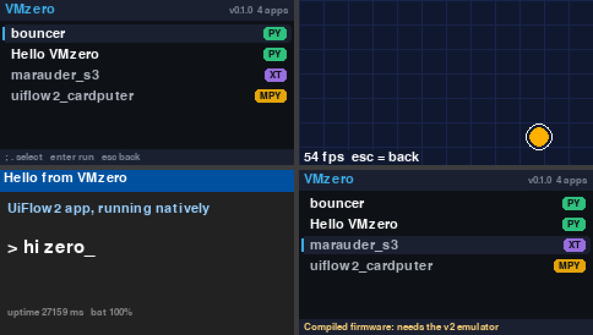

# VMzero

**Run M5Stack apps on the Cardputer Zero — natively where it can, emulated where it must.**

VMzero is a launcher for the M5Stack Cardputer Zero (and Zero Lite) that runs the
existing Cardputer / StickS3 app ecosystem through one library screen. Each app is
routed to the lightest execution path that works:

| Badge | Tier | What runs | Status |
|-------|------|-----------|--------|
| `PY`  | 1 — native | UiFlow2 / MicroPython source, on the Zero's own Python, via a hardware shim | **working (v0.1)** |
| `MPY` | 1 — native | MicroPython firmware `.bin` (scripts extracted, then run natively) | detected, extraction planned |
| `XT`  | 2 — emulated | Compiled Arduino/IDF ESP32-S3 firmware, in an Xtensa emulator with a device profile | detected, v2 |

The full concept and roadmap are in [docs/CONCEPT.md](docs/CONCEPT.md).



## What works in v0.1

- **Launcher** with app library, tier badges and automatic routing.
- **Tier 1 runtime**: unmodified UiFlow2-style apps run under CPython. `import M5`,
  `from M5 import *`, `from hardware import MatrixKeyboard`, `Widgets.Label(...)`,
  `M5.Lcd.fillRect(...)`, canvases, `time.ticks_ms()` / `sleep_ms()` all resolve to the shim.
- **Firmware inspection**: `.bin` files are identified by ESP image header (chip ID, e.g.
  ESP32-S3) and sorted into MicroPython vs. compiled builds.
- **Clean app isolation**: every launch gets fresh shim modules; Esc always returns to the
  launcher, even from a UiFlow2 `try/except Exception` main loop. Crashes show on screen.
- **Virtual screen per device profile**: apps keep drawing at 240×135 (Cardputer ADV);
  VMzero scales that onto whatever display it runs on.

## Run it

```bash
pip install pygame
python -m vmzero                 # desktop window, 3x scale
python -m vmzero --fullscreen    # on the Zero itself
python -m vmzero --apps ~/m5apps --profile sticks3
```

Keys: `;` / `.` (or arrows) select · Enter run · Esc back to the launcher · `r` rescan ·
F1 = the G0 button (`BtnA`).

## Adding apps

Drop them in `apps/`:

```
apps/my_app/main.py        # + optional app.json {"name", "author", "entry", "profile"}
apps/my_script.py
apps/some_firmware.bin
```

## Layout

```
vmzero/
  host.py        display + input host (pygame; desktop window or the Zero's panel)
  launcher.py    library screen and tier routing
  library.py     app discovery, .bin inspection (ESP image header, MicroPython detection)
  runtime.py     Tier 1 runner: installs the shim, executes the app, isolates it
  shim/
    lcd.py       M5.Lcd / M5.Display / canvases (M5GFX-style API)
    widgets.py   UiFlow2 Widgets: Label, Title, Rectangle, Circle, Image
    modules.py   M5, hardware, machine, utime, utility module builders
apps/            example apps (written exactly as for a real Cardputer)
tests/           headless smoke test (SDL dummy driver, scripted keys, screenshots)
```

## Next up

- Map the shim onto real Zero hardware once it ships: panel resolution, keyboard
  matrix, IR, speaker, GPIO.
- Unimplemented shim calls currently no-op; `VMZERO_STRICT=1` makes them raise, which
  turns every real-world app into a to-do list for the shim.
- MicroPython `.bin` script extraction (VFS/LittleFS partition reader).
- v2: the Xtensa emulation path and the first device profiles (Cardputer ADV, StickS3).
- v3: online catalogue link.

## Licence

Code: Apache License 2.0 — see [LICENSE](LICENSE) and [NOTICE](NOTICE).
The licence does not grant use of the **VMzero** name; forks are welcome under their own name.
Concept document: CC BY-ND 4.0 — see [docs/LICENSE-CONCEPT](docs/LICENSE-CONCEPT).

*VMzero is a project by Runaque. Not affiliated with M5Stack.*
